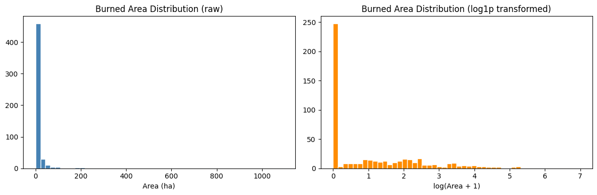
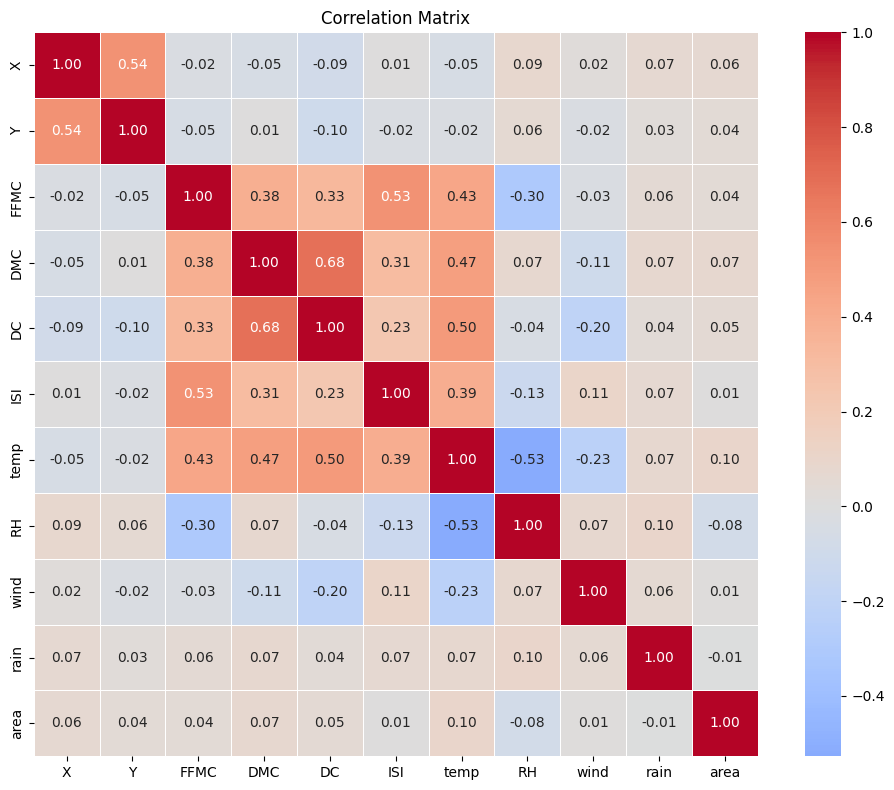
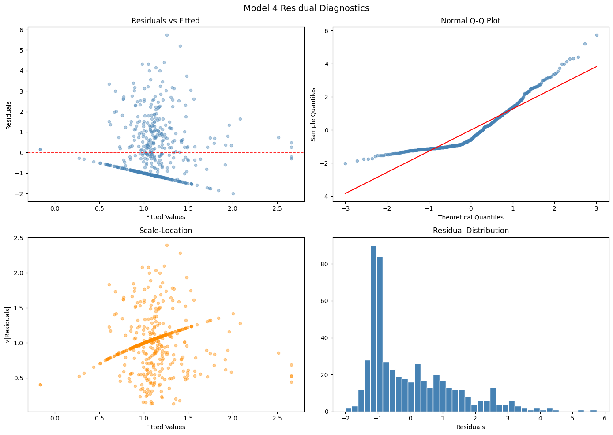
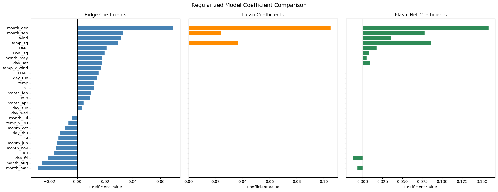
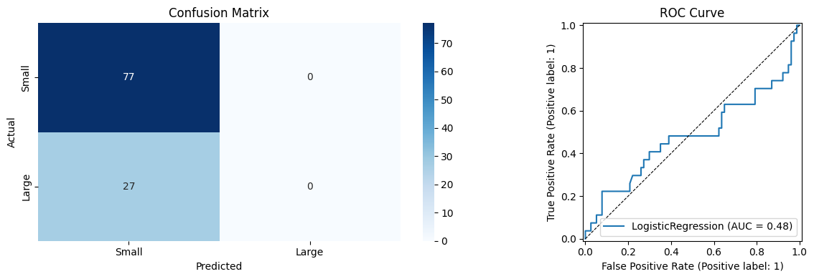

# Forest Fire Burned-Area Modelling

Can weather conditions and fire-danger indices predict how much land a forest fire burns? This project tests that question on the UCI Forest Fires dataset using regression, regularisation and logistic classification, and reports plainly what the data can and cannot support.

**Short answer:** very little. The best regression model explains under 5% of the variation in burned area, and the logistic classifier did not beat random guessing at spotting large fires. The value of this project is in the method, the diagnostics and the honest reading of weak results.

## Problem Statement

Forest fire managers need to know which fires are likely to become large, so that crews and equipment can be placed in advance. Burned area is the outcome that matters, but it is hard to predict: most fires stay small and a few are enormous. This project asks:

1. How much of the variation in burned area can be explained by meteorological variables and the Canadian Fire Weather Index (FWI) components?
2. Can a simple classifier separate "large" fires from "small" ones?

## Dataset

- **Source:** [UCI Machine Learning Repository, Forest Fires](https://archive.ics.uci.edu/dataset/162/forest+fires) (Cortez and Morais, 2007)
- **Location:** Montesinho Natural Park, northeast Portugal
- **Size:** 517 records, 12 input features, 1 target (`area`, burned area in hectares)
- **Features:** spatial coordinates (`X`, `Y`), `month`, `day`, FWI indices (`FFMC`, `DMC`, `DC`, `ISI`) and weather (`temp`, `RH`, `wind`, `rain`)
- **Missing values:** none

Two properties of the target shape the whole analysis:

- **247 of 517 records (48%) have a burned area of exactly zero.** In the source data this means less than 0.01 ha burned.
- **The target is extremely right-skewed** (skewness 12.85, maximum about 1,091 ha). A `log(area + 1)` transform reduces skewness to 1.22.



## Approach

1. **Load and inspect** the data through `ucimlrepo` (a copy of the CSV is also in this repo).
2. **Exploratory analysis:** target distribution, correlation matrix, predictor scatterplots against `log(area + 1)`, and a baseline residual check.
3. **Four OLS regression models** on `log(area + 1)`, each adding complexity:
   - Model 1: eight numeric predictors (`FFMC`, `DMC`, `DC`, `ISI`, `temp`, `RH`, `wind`, `rain`)
   - Model 2: Model 1 plus month and day-of-week indicator variables
   - Model 3: Model 1 plus quadratic terms (`temp²`, `DMC²`)
   - Model 4: Model 3 plus interaction terms (`temp × wind`, `temp × RH`)
4. **Diagnostics:** R², adjusted R², AIC, BIC, residual plots, Q-Q plots, normality tests, Durbin-Watson and Cook's distance.
5. **Regularisation:** Ridge, Lasso and ElasticNet tuned with 5-fold cross-validation over an alpha grid from 0.001 to 1000, with scaling done inside each fold and a mean-only predictor as the baseline to beat.
6. **Classification:** a binary "large fire" target (burned area above 6.37 ha, the median of the non-zero fires), standardised predictors, a stratified 80/20 train-test split (scaling fitted on the training set only) and logistic regression.
7. **Assumption check:** variance inflation factors (VIF) for multicollinearity.



## Key Results

### Regression: weather explains very little

| Model | R² | Adj. R² | AIC | BIC | F-test p-value |
|---|---|---|---|---|---|
| 1. Numeric predictors | 0.0199 | 0.0044 | 1820.56 | 1858.79 | 0.2472 |
| 2. + Month and day indicators | 0.0684 | 0.0210 | 1828.30 | 1938.75 | 0.0778 |
| 3. + Quadratic terms | 0.0405 | 0.0215 | 1813.57 | 1860.30 | 0.0205 |
| 4. + Interaction terms | 0.0461 | 0.0234 | 1814.51 | 1869.74 | 0.0201 |

- **No model explains more than 7% of the variation** in log burned area, and the best adjusted R² is 0.023.
- **The selection criteria disagree.** AIC prefers Model 3, BIC prefers Model 1 and adjusted R² prefers Model 4. When the criteria split like this, it usually means none of the models has found a strong signal.
- **Models 3 and 4 pass the overall F-test at the 5% level**, and only `temp` and `temp²` are individually significant (p < 0.05). `DMC`, `DMC²` and both interaction terms are not. That is a statistically detectable effect, but practically a very small one.
- **Month and day indicators (Model 2) raise R² but are penalised heavily** by AIC and BIC because they add 17 parameters for little gain.

### Diagnostics for Model 4

- Residuals are right-skewed (skew 1.23) with heavy tails (kurtosis 4.07). Omnibus and Jarque-Bera tests both reject normality (p < 0.001), so p-values from these models should be treated with caution.
- The Durbin-Watson statistic is 0.94, well below 2, which points to positive autocorrelation in the residuals. The records may be ordered in time or space in a way the models do not capture.
- 20 observations exceed the Cook's distance threshold of 4/n, so a small number of large fires pull on the fit.



### Regularisation: no real gain

| Model | Best alpha | 5-fold CV MSE |
|---|---|---|
| Mean-only baseline | n/a | 1.9541 |
| Ridge | 1000 (edge of grid) | 1.9544 |
| Lasso | 0.1 | 1.9282 |
| ElasticNet (l1 ratio 0.5) | 0.1 | 1.9431 |

Ridge never beat a model that always predicts the average: its best alpha was the largest value tried, and at that level it simply reproduces the baseline. Lasso did best, but only about 1.3% below the baseline, and ElasticNet about 0.6% below. Lasso's final fit kept just 3 of 29 coefficients, another sign that few features carry any signal.



### Classification: the model never predicted a large fire

| Metric | Value |
|---|---|
| Accuracy | 0.740 |
| ROC-AUC | 0.481 |
| Recall, large fires | 0.00 |
| Precision, large fires | 0.00 |

The 74% accuracy is misleading. About 74% of fires in the data are "small", and the logistic regression simply predicted "small" for every test case (77 correct, 27 large fires missed). A ROC-AUC of 0.48 means the predicted probabilities ranked fires no better than chance. VIF values were all below 2.7, so multicollinearity is not the explanation.



## Conclusions

- Meteorological variables and FWI indices, used on their own, are weak predictors of how large a fire becomes. This matches the dataset authors' own description of it as "a very difficult regression task."
- Added model complexity (categoricals, quadratics, interactions) did not produce a model worth deploying, and regularisation barely improved on a mean-only prediction. The simplest models are as defensible as the complex ones.
- For the classification task, accuracy alone would have made a useless model look acceptable. Recall, ROC-AUC and the confusion matrix showed the real picture.

## Limitations and Next Steps

- **The spatial coordinates `X` and `Y` were not used** in the models. Location may carry more signal than weather.
- **Class imbalance was not addressed.** Next steps are `class_weight="balanced"`, tuning the decision threshold on predicted probabilities, and evaluating with precision-recall curves.
- **Only linear models were tried.** Tree-based models (random forest, gradient boosting) can capture non-linear thresholds that regression terms miss.
- **Zero-area fires are mixed in with small fires.** A two-stage model (does the fire burn anything, then how much) is a natural alternative.
- **The data are a 2007 snapshot from one park**, so results may not transfer to other regions or climates.
- **Residual autocorrelation** suggests time-aware validation would be more appropriate than random splits.

## Tech Stack

Python, pandas, NumPy, matplotlib, seaborn, scikit-learn, statsmodels, SciPy, Jupyter

## How to Run

```bash
git clone https://github.com/ElvisOmondi7/Summative_Lab_Forest_Fires_Prevention.git
cd Summative_Lab_Forest_Fires_Prevention
pip install -r requirements.txt
jupyter notebook C06M08Lab.ipynb
```

The notebook downloads the data with `ucimlrepo` and falls back to the local `forestfires.csv` if the download fails, so it also runs offline. `forestfires.names` documents the variables.

## Repository Contents

```
.
├── C06M08Lab.ipynb      # Full analysis notebook
├── forestfires.csv      # Dataset (517 records)
├── forestfires.names    # Variable descriptions from UCI
├── images/              # Charts used in this README
├── requirements.txt     # Python dependencies
└── README.md
```

## Reference

P. Cortez and A. Morais. A Data Mining Approach to Predict Forest Fires using Meteorological Data. In J. Neves, M. F. Santos and J. Machado (Eds.), *New Trends in Artificial Intelligence, Proceedings of the 13th EPIA 2007 - Portuguese Conference on Artificial Intelligence*, Guimaraes, Portugal, pp. 512-523, 2007.

## Author

**Elvis Omondi Okoth**, Data Science and Statistics, Nairobi, Kenya

[LinkedIn](https://www.linkedin.com/in/elvis-omondi-200a06264) | okothelvisomondi@gmail.com | [GitHub](https://github.com/ElvisOmondi7)

Completed as a summative lab in the Data Science program at Moringa School.
